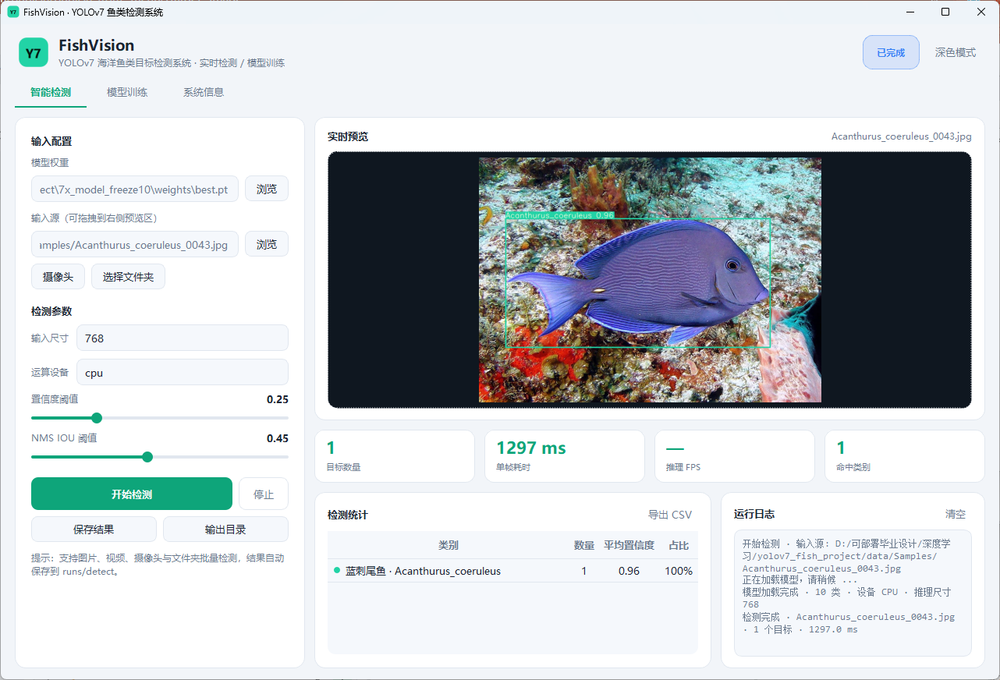
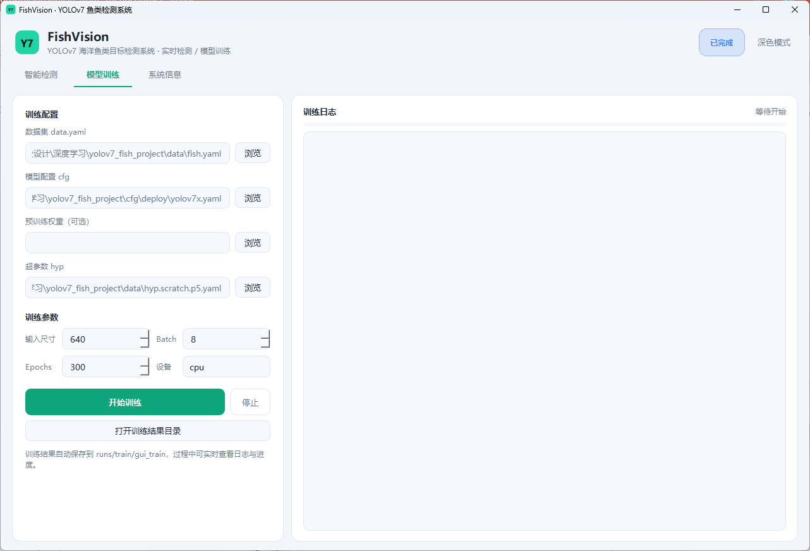
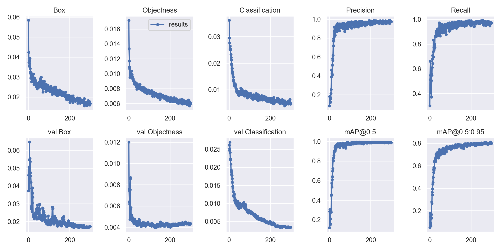

# YOLOv7-Marine-Fish-Object-Detection-System<div align="center">

# FishVision · YOLOv7 海洋鱼类目标检测系统
# 源码获取：https://mbd.pub/o/bread/YZaWl5ltaQ==

基于 YOLOv7x 的 10 类海洋鱼类检测项目，配套 PyQt5 桌面端界面，支持图片 / 视频 / 摄像头实时检测、文件夹批量推理、结果统计导出与界面内训练。

[](https://www.python.org/)
[](https://pytorch.org/)
[](https://github.com/WongKinYiu/yolov7)
[](https://pypi.org/project/PyQt5/)

</div>

---

## 项目简介

本项目基于 [YOLOv7](https://github.com/WongKinYiu/yolov7) 完成海洋鱼类的目标检测与分类，在官方代码基础上做了以下工作：

- 整理 10 类海洋鱼类数据集（共 1180 张图像，YOLO 格式标注），并提供 VOC XML 转 YOLO 的完整脚本
- 使用 **YOLOv7x + 冻结骨干前 10 层** 微调 300 epoch，验证集 **mAP@0.5 最高 99.4%**
- 使用 PyQt5 实现桌面端 GUI：实时检测、摄像头、文件夹批量、训练监控、统计与 CSV 导出
- 保留官方训练 / 评估 / 导出（ONNX、TensorRT）能力，便于二次开发与部署

## 界面预览

| 智能检测 | 模型训练 |
| :---: | :---: |
|  |  |

训练过程指标曲线（Box / Objectness / Classification / Precision / Recall / mAP）：



## 检测类别

| ID | 中文名 | 类别名 |
| :--: | :-- | :-- |
| 0 | 蓝刺尾鱼 | `Acanthurus_coeruleus` |
| 1 | 单棘鲀 | `Aluterus_scriptus` |
| 2 | 灰礁鲨 | `Carcharhinus_amblyrhynchos` |
| 3 | 大白鲨 | `Carcharodon_carcharias` |
| 4 | 黄尾九棘鲈 | `Cephalopholis_fulvaw` |
| 5 | 刺河豚 | `Diodon_holocanthus` |
| 6 | 皇后神仙鱼 | `Pomacanthus_imperator` |
| 7 | 法国神仙鱼 | `Pomacanthus_paru` |
| 8 | 狮子鱼 | `Pterois_volitans` |
| 9 | 鲸鲨 | `Rhincodon_typusw` |

## 数据集

| 划分 | 图像数量 | 说明 |
| :-- | :--: | :-- |
| 训练集 | 955 | `data/train.txt` |
| 验证集 | 107 | `data/val.txt` |
| 测试集 | 118 | `data/test.txt` |
| 合计 | 1180 | 图像位于 `data/images`，标签位于 `data/labels` |

数据集配置见 [fish.yaml](file:///d:/可部署毕业设计/深度学习/yolov7_fish_project/data/fish.yaml)，采用单类别单框的经典检测标注，可直接用于 YOLOv7 训练。

## 训练结果

训练配置：YOLOv7x，输入 640×640，batch 8，300 epoch，冻结骨干前 10 层，`hyp.scratch.p5.yaml`。

| 指标 | 结果 |
| :-- | :-- |
| mAP@0.5 | **99.4%**（最优 epoch 146） |
| mAP@0.5:0.95 | **81.1%**（最优 epoch 295） |
| Precision | 0.969 |
| Recall | 0.980 |
| 权重文件 | `7x_model_freeze10/weights/best.pt`（约 136 MB） |

完整的训练日志、PR 曲线、混淆矩阵与验证集可视化位于 `7x_model_freeze10/`，训练曲线见上方图片。

## 项目结构

```text
yolov7_fish_project/
├── cfg/                   # 网络结构配置（deploy/yolov7.yaml、yolov7x.yaml 等）
├── data/                  # 数据集配置、划分文件与样例
│   ├── fish.yaml          # 10 类鱼类数据集配置
│   ├── train.txt / val.txt / test.txt
│   ├── Samples/           # 未参与训练的样例图片
│   └── video/             # 演示视频
├── models/                # YOLOv7 网络结构（common.py / yolo.py / experimental.py）
├── utils/                 # 数据加载、NMS、绘图、指标计算等工具
├── deploy/                # Triton Inference Server 部署示例
├── inference/             # 通用推理示例图片
├── 7x_model_freeze10/     # YOLOv7x 冻结训练输出（best.pt、曲线、日志）
├── weights/               # 官方预训练权重 yolov7.pt / yolov7x.pt
├── runs/                  # 训练与检测运行结果
├── assets/                # README 展示图
├── gui.py                 # PyQt5 图形界面（智能检测 + 模型训练 + 系统信息）
├── detect.py              # 命令行推理入口
├── train.py               # 训练入口
├── test.py                # 评估入口
├── export.py              # ONNX / TensorRT / CoreML 等导出
├── split_train_val.py     # 数据集划分脚本
├── voc_label.py           # VOC XML → YOLO 标签转换
└── requirements.txt
```

## 快速开始

### 1. 环境要求

- Python 3.7+（推荐 3.7.x）
- PyTorch 1.7+，可选 CUDA 加速（无 GPU 也可用 CPU 推理）
- Windows / Linux 均可，GUI 在 Windows 下验证

### 2. 安装依赖

```bash
pip install -r requirements.txt
pip install PyQt5        # GUI 额外依赖，requirements.txt 未包含
```

如需 GPU 推理，请先到 [pytorch.org](https://pytorch.org/) 安装与显卡匹配的 PyTorch 与 CUDA 版本。

### 3. 准备权重

| 权重 | 用途 |
| :-- | :-- |
| `weights/yolov7x.pt` | 官方预训练权重，用于迁移学习训练 |
| `7x_model_freeze10/weights/best.pt` | 本项目训练好的权重，用于检测与评估 |

### 4. 启动图形界面

```bash
python gui.py
```

- **智能检测**：选择权重与输入源（图片 / 视频 / 摄像头 / 文件夹），可拖拽文件到预览区，调整输入尺寸、置信度、IOU 后开始检测；右侧显示目标数量、单帧耗时、类别与平均置信度，支持导出 CSV。
- **模型训练**：选择 `data.yaml`、模型 cfg、预训练权重与 hyp，设置 img / batch / epoch / device 后启动训练，日志实时滚动，输出保存到 `runs/train/gui_train*`。
- **系统信息**：查看 Python、PyTorch、CUDA、OpenCV、Qt 版本，以及类别配色与支持的输入格式。

### 5. 命令行检测

```bash
# 使用样例图片批量检测
python detect.py --weights 7x_model_freeze10/weights/best.pt --img-size 640 --source data/Samples

# 单张图片 / 视频 / 摄像头（0 表示默认摄像头）
python detect.py --weights 7x_model_freeze10/weights/best.pt --img-size 640 --source data/video/1.mp4
python detect.py --weights 7x_model_freeze10/weights/best.pt --source 0
```

检测结果默认保存到 `runs/detect/exp*`，每次运行自动递增目录名。

### 6. 训练

```bash
# 推荐：YOLOv7x，冻结骨干前 10 层
python train.py --img 640 --batch 8 --epoch 300 --data data/fish.yaml \
  --cfg cfg/deploy/yolov7x.yaml --weights weights/yolov7x.pt --device 0 --freeze 10

# 轻量：YOLOv7
python train.py --img 640 --batch 8 --epoch 200 --data data/fish.yaml \
  --cfg cfg/deploy/yolov7.yaml --weights weights/yolov7.pt --device 0
```

### 7. 评估

```bash
python test.py --weights 7x_model_freeze10/weights/best.pt --data data/fish.yaml \
  --img-size 640 --batch-size 8 --task test --device 0 --verbose
```

### 8. 导出与部署（可选）

```bash
# 导出 ONNX
python export.py --weights 7x_model_freeze10/weights/best.pt --grid --simplify --img-size 640 640

# 端到端 ONNX（含 NMS）
python export.py --weights 7x_model_freeze10/weights/best.pt --grid --end2end \
  --simplify --topk-all 100 --iou-thres 0.65 --conf-thres 0.35 --img-size 640 640
```

`deploy/triton-inference-server/` 提供了 Triton 部署客户端与预处理示例。

## 数据集制作流程

若使用自己的 VOC 格式数据，可按以下步骤接入：

1. 将图片放入 `data/images/`，XML 标注放入 `data/Annotations/`
2. 划分训练 / 验证 / 测试集（默认 trainval 90%，其中 90% 训练，即约 81% / 9% / 10%）：

   ```bash
   python split_train_val.py --xml_path data/Annotations --txt_path data/ImageSets
   ```

3. 转换 XML 为 YOLO 标签并生成 `data/train.txt`、`val.txt`、`test.txt`：

   ```bash
   python voc_label.py
   ```

4. 修改 `data/fish.yaml` 中的 `train / val / test` 路径与 `names`、`nc`

> `voc_label.py` 顶部的 `classes` 列表需与你的类别顺序保持一致。

## 常见问题

**Q：`pip install matplotlib==3.2.2` 安装失败？**

A：旧版本在新 Python / 新系统上可能缺少预编译 wheel。可换国内镜像，或改用 `matplotlib>=3.5`（本项目训练与推理不依赖该版本差异）。

**Q：启动 GUI 报 `No module named 'PyQt5'`？**

A：执行 `pip install PyQt5`，建议在虚拟环境中安装，避免与系统 Qt 冲突。

**Q：CPU 推理很慢？**

A：YOLOv7x 参数量较大，建议安装 CUDA 版 PyTorch，并在界面「运算设备」或命令行的 `--device 0` 中选择 GPU。640 输入下单张图片 CPU 推理约 1s 量级。

**Q：找不到检测结果？**

A：命令行结果在 `runs/detect/exp*`，GUI 结果在 `runs/detect/gui_*`，训练结果在 `runs/train/`。可在界面点击「输出目录」直接打开。

**Q：显存不足（OOM）？**

A：减小 `--batch 8` 到 4 或 2，或降低 `--img 640`，也可使用更小的 `yolov7.yaml` 而非 `yolov7x.yaml`。

## 参考与致谢

- [WongKinYiu/yolov7](https://github.com/WongKinYiu/yolov7) — 官方实现
- YOLOv7 论文：*YOLOv7: Trainable bag-of-freebies sets new state-of-the-art for real-time object detectors*（[arXiv:2207.02696](https://arxiv.org/abs/2207.02696)），PDF 见 `paper/yolov7.pdf`
- 数据集与预训练权重版权归原作者所有

## 声明

本项目及其中的数据、权重仅用于学习与研究，请勿用于商业用途。使用第三方数据集或预训练权重时，请遵守其原始许可协议。
